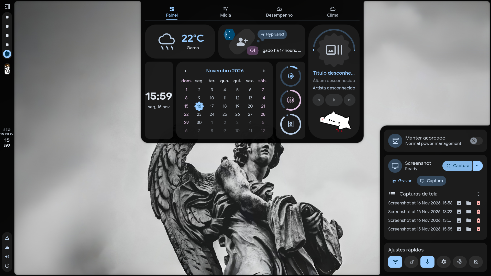

# dotfiles.

A personalized [Omarchy](https://omarchy.org) workstation: Hyprland driven by Lua config and the Omacale shell, LazyVim for editing, and an input stack carefully engineered so `us-intl` dead keys keep working in every application — browsers, Electron, Qt and winit alike.

Everything lives in [`home/`](home/), mirroring `$HOME`. `scripts/link.py` turns each file into a symlink at its original path; machine-specific settings are layered on top from [`hosts/`](hosts/).

`Arch Linux` · `Omarchy 4` · `Hyprland 0.56` · `Omacale shell` · `Ghostty` · `fish` · `Starship` · `Neovim + LazyVim`

## Desktop preview


## Why this repository exists

Omarchy installs a complete, opinionated Hyprland desktop in minutes. This repository is the layer on top of it: the parts of the machine that are *mine*, kept in git so a fresh Omarchy install becomes this desktop again with two commands.

- **What comes from Omarchy** stays upstream: the Hyprland bootstrap, the shell engine, themes mechanics, update migrations. Nothing under `/usr/share/omarchy` is forked.
- **What is mine** is versioned here: keybindings and look-and-feel, the Omacale bar (a modified copy of the upstream plugin), notification/OSD/lock plugins, application wrappers, Neovim, fish, Ghostty, and two self-maintained themes.
- **How it applies**: symlinks, not copies. The repo never edits Omarchy itself — it overrides after the defaults load, so package updates keep improving the base without touching this repo.
- **Shared vs. host-specific**: [`home/`](home/) is the common config; [`hosts/visao/`](hosts/visao/) overrides it per machine (monitor layout, autostart). `scripts/link.py` picks the overlay by hostname — or `DOTFILES_HOST`, if you want to force one.

## Components

**Desktop and window management**

- Hyprland 0.56 with Omarchy's Lua configuration layer — personal overrides in `bindings.lua`, `looknfeel.lua`, `monitors.lua`
- Omacale bar — a Caelestia-style Quickshell shell for Omarchy, vendored and modified (v0.58.0)
- `vz.lock`, `vz.notifications`, `vz.osd` — patched clones of Omarchy's stock service plugins, handing popups, OSD and lock rendering over to Omacale
- `gsr-replay.service` — GPU Screen Recorder replay buffer (last 60 s) as a systemd user unit, with Hyprland binds for instant clips

**Terminal and shell**

- Ghostty as the daily terminal; foot, Alacritty and kitty kept as theme-synced alternates with the same CSI-u key encoding
- fish as login shell, mirroring Omarchy's `mise` + Starship init and adding zoxide
- Starship prompt: two-level truncated path, cyan `❯`, minimal git status glyphs

**Editor and development tools**

- Neovim + LazyVim: Harpoon 2, Telescope, toggleterm with a 3-slot terminal stack (`ALT+1..3`)
- `java_menu` — an in-house Neovim plugin: interactive Java type/package creation, refactoring, imports, Maven/Gradle build & run, tests and debug over jdtls
- mise for toolchains, lazygit, Docker, and a Maven/Gradle-aware jdtls setup that keeps exactly one LSP client per project

**Themes and visual integration**

- **Aether** — palette generated from the Fedora 42 wallpaper, applied system-wide by the `aether` package and kept versioned here
- **fedora-42** — an Adwaita-dark theme after Fedora Workstation (wallpapers credited upstream)
- [owe](https://github.com/omacom/owe) wallpaper engine + a `theme-set` hook that re-syncs it on every theme change
- A `theme-set` hook that regenerates ZapFast's palette and live-reloads the app
- btop theme hand-matched to the Aether palette

**Utilities and workflow**

- Waystone price-check overlay for Path of Exile 2, bound through window-class-gated Hyprland binds
- Superwhisper dictation panel in the bar; Bitwarden on a global keybind
- `pdf2epub` — a local PDF → EPUB3 converter (Marker + Pandoc) with memory-capped chunking, kept in `~/.local/share/pdf2epub`

## Customizations

Full technical breakdown in [docs/customizations.md](docs/customizations.md). The distinctive parts:

### Vim-style window workflow

`SUPER+H/J/K/L` move focus and `SUPER+SHIFT+H/J/K/L` swap windows directionally, replacing Omarchy's defaults for those keys. The quick-bindings popup moved to `SUPER+;` so `SUPER+C` stays plain copy. Screenshot to a data disk, game-clip and recording binds round it out:

| Keys | Action |
| --- | --- |
| `SUPER+H/J/K/L` | focus left/down/up/right |
| `SUPER+SHIFT+H/J/K/L` | swap window in that direction |
| `SUPER+A` / `SUPER+D` / `SUPER+N` / `SUPER+U` | Omacale launcher / dashboard / notifications / quick toggles |
| `SUPER+/` and `SUPER+,` | save last 60 s clip · start/stop recording |
| `SUPER+.` | fullscreen screenshot to `/data/midia/fotos/screenshots` |
| `ALT+Z` / `ALT+X` | Waystone price check / unique scan (only while a PoE2 window is focused) |

### Omacale as the shell

The stock Omarchy bar is replaced by a modified `omacale.bar` — clock with week-number alt format, world clocks (São Paulo, London, Dubai, Tokyo, LA), weather, tray and the Superwhisper panel. Omarchy's stock notifications, OSD and lock are disabled in `shell.json` in favor of the `vz.*` clones below. Omacale is a fork: upstream updates have to be merged by hand (`upstream-check` inside the plugin helps).

### Patched service plugins

`vz.notifications` and `vz.osd` are Omarchy's stock plugins patched by Omacale's handover so the stock daemon goes headless while Omacale draws its own toasts and sliders — with health checks that fall back to the stock surface if the bar ever fails to load. They are kept versioned so a reinstall reproduces the exact patched state.

### Dead-key-proof input stack

Hyprland still lacks `text-input-v3`, which breaks `us-intl` composition on Wayland-native GTK 4, Electron, Qt and winit apps. The fix is a layered strategy: `GTK_IM_MODULE=simple` for GTK, all XWayland displays forced to `us-intl` at login by a systemd user unit, and per-app wrappers (`firefox-xwayland`, `chromium`, `zapfast-x11`, `omawrite-x11`, `nectarlink-x11`) that pin each app to the backend that composes correctly. The reasoning and per-app details live in [docs/troubleshooting.md](docs/troubleshooting.md).

### Theme pipeline

Two self-maintained themes: **Aether** (generated from the Fedora 42 day wallpaper, accent `#4a8e64` on near-black `#130300`) and **fedora-42** (Adwaita dark). The neutral window border is sampled from the theme foreground; `hooks/theme-set.d/` re-syncs owe wallpapers and ZapFast's palette on every theme switch, and Ghostty/foot/Alacritty/kitty/btop all read the current theme at startup.

### Editor: LazyVim with a real Java IDE

On top of LazyVim: tokyonight, Harpoon 2 for file navigation, a disciplined 3-terminal toggleterm stack, and a Java toolchain built on nvim-jdtls + jc.nvim + the in-house `java_menu` plugin (`<leader>j*`): new type/package wizards, refactors, import ordering, Maven/Gradle build and run, neotest via jc's adapter, and DAP wired to java-debug/java-test bundles from Mason — with guards that keep a single jdtls client per project.

## Gallery

| Development environment | Shell / widgets |
| --- | --- |
|  |  |

## Installation

**Prerequisites:** Omarchy already installed, plus `git` and `python3`. Nothing else — the installer refuses to run outside Omarchy.

```bash
git clone https://github.com/EdevandoAlves/dotfiles ~/dotfiles
cd ~/dotfiles
```

Pick one:

```bash
# 1. Preview — prints every link and backup it would make, changes nothing
python3 scripts/link.py --dry-run

# 2. Links only — symlinks the config, installs no packages
python3 scripts/link.py

# 3. Full installer — packages + links + theme + services
./scripts/install.sh            # or --no-packages to skip pacman/yay
```

Mode 3 runs `pacman`/`yay` with `--noconfirm` over a snapshot of this machine's full package list (`packages/pacman.txt`), which includes hardware-specific drivers (NVIDIA, `amd-ucode`, `intel-ucode`), a Docker stack and personal apps. Review those lists before running it on different hardware — it is a machine snapshot, not a curated dependency set. Existing files are always moved to `~/.dotfiles-backup/<timestamp>/` first; see [docs/recovery.md](docs/recovery.md) for rollback.

After linking, restart the shell and terminal:

```bash
omarchy restart shell && omarchy restart terminal
```

Detailed prerequisites, package behavior and verification steps: [docs/installation.md](docs/installation.md).

## Repository structure

```text
.
├── assets/            # screenshots (desktop, editor, shell)
├── docs/              # installation, customizations, troubleshooting, recovery
├── home/              # $HOME mirror — every file becomes a symlink
│   ├── .config/hypr/          # Hyprland Lua config (bindings, look'n'feel, monitors)
│   ├── .config/omarchy/       # shell.json, hooks, themes (aether, fedora-42), plugins
│   ├── .config/ghostty/       # terminal config + local background override
│   ├── .config/fish/          # login shell init (mise, starship, zoxide)
│   ├── .config/nvim/          # LazyVim + java_menu plugin
│   ├── .local/bin/            # app wrappers (firefox-xwayland, zapfast-x11, …)
│   ├── .local/share/pdf2epub/ # local PDF → EPUB converter
│   └── .config/systemd/user/  # xwayland-us-intl, gsr-replay units
├── hosts/             # per-machine overlay, applied over home/ (visao: monitors, autostart)
├── packages/          # pacman.txt (full snapshot) and aur.txt
└── scripts/           # install.sh (packages + links + theme), link.py (symlinks)
```

Plugins and themes (`omacale.bar`, `vz.*`, both themes, the Omarchy agent skill) are linked as whole directories so their internal state stays consistent.

## Documentation

- [Installation](docs/installation.md) — prerequisites, installation modes, package behavior, host overlays (Portuguese)
- [Customizations](docs/customizations.md) — technical breakdown of every modification (Portuguese)
- [Troubleshooting](docs/troubleshooting.md) — the Wayland dead-key problem and its per-app fixes (Portuguese)
- [Recovery](docs/recovery.md) — backup strategy, rollback, known risks (Portuguese)

## Credits

Nothing here would exist without the projects below. Third-party code included in this repository keeps its own license and is not claimed as original work.

- [Omarchy](https://omarchy.org) ([source](https://github.com/omacom/omarchy)) — the base system, the Hyprland Lua layer, the shell engine, and the stock service plugins behind the `vz.*` clones
- [Omacale](https://github.com/AyushKr2003/omacale) by AyushKr2003 (GPL-3.0) — the shell bar, vendored and modified; it builds on [Caelestia](https://github.com/caelestia-dots/shell), [Omakit](https://github.com/mtolhuys/omakit), [Serpantinum](https://github.com/ilyamiro/serpantinum) and [Vitreus](https://github.com/natepayn3/Vitreus), as documented in its `THIRD_PARTY.md`
- [Aether](https://github.com/omacom/aether) — wallpaper-driven theme generation; the `aether` and `fedora-42` themes here include its output
- Fedora Design Team — Fedora 42 wallpapers, CC-BY-SA 4.0, credited in the theme's `CREDITS.md`
- [LazyVim](https://www.lazyvim.org) and the Neovim plugin ecosystem — Harpoon, Telescope, toggleterm, nvim-jdtls, jc.nvim, Mason, neotest
- [ZapFast](https://zapfast.rocks), [Omawrite](https://github.com/omacom/omawrite), [NectarLink](https://github.com/thtbee/nectarlink), [Limusic](https://github.com/SimoHypers/limusic), [Waystone](https://github.com/kriskruse/waystone), [Superwhisper](https://superwhisper.com), [GPU Screen Recorder](https://git.dec05eba.com/gpu-screen-recorder) — native apps this config wraps, binds and themes

Plugin and theme directories carry their own `LICENSE`/`CREDITS` files upstream of this README.
